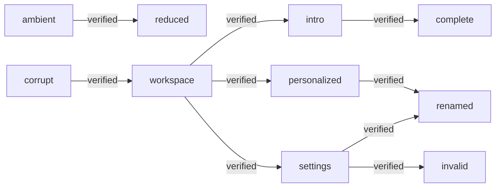

# Coverage

Generated by `pnpm coverage:generate`. Browser percentages cover preference infrastructure only; component behavior is covered through journeys, never component unit tests.

Cucumber: 11/11 scenarios passed. Extension Playwright: 1 passed, 0 failed.

## System Journey Graph

Edges come from scenario transition tags. An edge is verified only when all scenarios declaring it passed.

## State-Fusion Matrix

Rows record states asserted together in one executed scenario; this is observed coverage, not an exhaustive Cartesian-product claim.

| Journey | Mood | Name | Ambient | Reduce Motion | Validation | Recovery | Intro | Result |
| --- | --- | --- | --- | --- | --- | --- | --- | --- |
| Reduce Motion suppresses decorative shaders | — | — | ✓ | ✓ | — | — | — | passed |
| Read the introduction at my own pace | — | — | — | — | — | — | ✓ | passed |
| Change and persist the "outline" icon mood | ✓ | — | — | — | — | — | — | passed |
| Change and persist the "duotone" icon mood | ✓ | — | — | — | — | — | — | passed |
| Change and persist the "fill" icon mood | ✓ | — | — | — | — | — | — | passed |
| Change and persist the "pixel" icon mood | ✓ | — | — | — | — | — | — | passed |
| Change and persist the "glass" icon mood | ✓ | — | — | — | — | — | — | passed |
| Save a personal name | — | ✓ | — | — | — | — | — | passed |
| Reject a blank name | — | — | — | — | ✓ | — | — | passed |
| Compose mood, name and ambient preferences | ✓ | ✓ | ✓ | — | — | — | — | passed |
| Recover invalid stored preferences | — | — | — | — | — | ✓ | — | passed |

## Feature Namespace Disposition

| Namespace | Disposition | Owner | Evidence | Scope |
| --- | --- | --- | --- | --- |
| preferences | active | [src/features/preferences](./src/features/preferences) | 9/9 passed | Mood, name, durable storage and recovery. |
| ambient | active | [src/features/ambient](./src/features/ambient) | 1/1 passed | Opt-in shader effects and system Reduce Motion. |
| introduction | active | [src/features/introduction](./src/features/introduction) | 1/1 passed | Host-controlled Cuelens onboarding. |
| extension | integration | [tests/extension](./tests/extension) | 1 passed | Packaged MV3 cross-page behavior is verified by Playwright. |
| custom-ui | reserved | [src/shared/ui](./src/shared/ui) | not run | User-owned component library integration boundary. |

## Browser Infrastructure Coverage

| Metric | Percent |
| --- | --- |
| statements | 70.58% |
| branches | 67.74% |
| functions | 81.81% |
| lines | 75% |

Raw reports: `reports/cucumber.json`, `reports/extension.json`, and `coverage/browser/coverage-summary.json`. Missing reports are never counted as passing.
