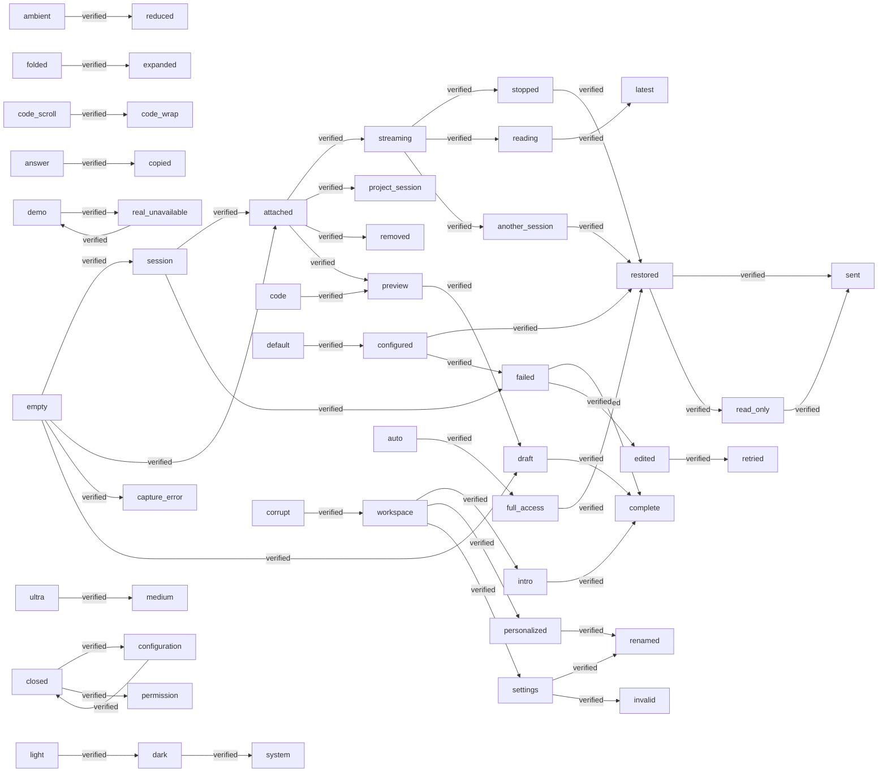

# Coverage

Generated by `pnpm coverage:generate`. Browser percentages cover preference, storage, capture and transport infrastructure; component behavior is covered through journeys, never component unit tests.

Cucumber: 32/32 scenarios passed. Extension Playwright: 8 passed, 0 failed.

## System Journey Graph

Edges come from scenario transition tags. An edge is verified only when all scenarios declaring it passed.

## State-Fusion Matrix

Rows record states asserted together in one executed scenario; this is observed coverage, not an exhaustive Cartesian-product claim.

| Journey | ambient | capability | composer | connection | context | draft | failed | history | intro | keyboard | mood | name | narrow | permission | persistence | project | recovery | reduced-motion | retry | run-config | scroll | security | streaming | theme | validation | Result |
| --- | --- | --- | --- | --- | --- | --- | --- | --- | --- | --- | --- | --- | --- | --- | --- | --- | --- | --- | --- | --- | --- | --- | --- | --- | --- | --- |
| Reduce Motion suppresses decorative shaders | ✓ | — | — | — | — | — | — | — | — | — | — | — | — | — | — | — | — | ✓ | — | — | — | — | — | — | — | passed |
| Create, attach, send, stop and reopen history | — | — | — | — | ✓ | — | — | ✓ | — | — | — | — | — | — | — | — | — | — | — | — | — | — | ✓ | — | — | passed |
| Failed output keeps the draft and retries the same turn | — | — | — | — | — | ✓ | ✓ | — | — | — | — | — | — | — | — | — | — | — | — | — | — | — | ✓ | — | — | passed |
| Retrying an old turn does not consume a new draft | — | — | — | — | — | ✓ | ✓ | ✓ | — | — | — | — | — | — | — | — | — | — | — | — | — | — | — | — | — | passed |
| Composition and Shift Enter do not submit prematurely | — | — | — | — | — | ✓ | — | — | — | ✓ | — | — | — | — | — | — | — | — | — | — | — | — | — | — | — | passed |
| Streaming respects a reader who scrolled up | — | — | — | — | — | — | — | — | — | — | — | — | — | — | — | — | — | — | — | — | ✓ | — | ✓ | — | — | passed |
| Untrusted HTML and unsafe links are inert | — | — | — | — | — | — | — | — | — | — | — | — | — | — | — | — | — | — | — | — | — | ✓ | — | — | — | passed |
| Lody message rows preserve folding, content rails and code controls | — | — | — | — | ✓ | — | — | ✓ | — | ✓ | — | — | ✓ | — | — | — | — | — | — | — | — | — | — | — | — | passed |
| Message and code copy actions retain original text and reset feedback | — | — | — | — | — | — | — | ✓ | — | ✓ | — | — | — | — | — | — | — | — | — | — | — | ✓ | — | — | — | passed |
| Real mode cannot silently fall back to demonstration data | — | — | — | ✓ | — | — | — | ✓ | — | — | — | — | — | — | — | — | — | — | — | — | — | — | — | — | — | passed |
| An old response never enters a new conversation | — | — | — | — | — | ✓ | — | ✓ | — | — | — | — | — | — | — | — | — | — | — | — | — | — | ✓ | — | — | passed |
| Opt in to a matching GitHub project from the machine catalog | — | — | — | — | ✓ | — | — | — | — | — | — | — | — | — | — | ✓ | — | — | — | — | — | — | — | — | — | passed |
| Read the introduction at my own pace | — | — | — | — | — | — | — | — | ✓ | — | — | — | — | — | — | — | — | — | — | — | — | — | — | — | — | passed |
| Preview the source before sending and remove it | — | — | — | — | ✓ | — | — | — | — | — | — | — | — | — | — | — | — | — | — | — | — | — | — | — | — | passed |
| Browser preview explains that tab access is unavailable | — | — | — | — | ✓ | — | ✓ | — | — | — | — | — | — | — | — | — | — | — | — | — | — | — | — | — | — | passed |
| Original run configuration searches models and persists real draft selections | — | — | — | — | — | — | — | — | — | ✓ | — | — | ✓ | — | ✓ | — | — | — | — | ✓ | — | — | — | — | — | passed |
| Switching to a model without Ultra reconciles the reasoning options | — | ✓ | — | — | — | — | — | — | — | — | — | — | ✓ | — | — | — | — | — | — | ✓ | — | — | — | — | — | passed |
| Retry preserves the failed turn configuration while a draft can choose another model | — | — | — | — | — | ✓ | ✓ | — | — | — | — | — | — | — | — | — | — | — | ✓ | ✓ | — | — | — | — | — | passed |
| A narrow sidebar supports both palettes and keyboard controls | — | — | — | — | — | — | — | — | — | ✓ | — | — | ✓ | — | — | — | — | — | — | — | — | — | — | ✓ | — | passed |
| The sidebar retains Lody composer geometry and shortcut focus | — | — | ✓ | — | — | ✓ | — | — | — | — | — | — | ✓ | — | — | — | — | — | — | — | — | — | — | — | — | passed |
| Composer controls disclose the available runtime and read-only context boundary | — | — | ✓ | — | — | — | — | — | — | ✓ | — | — | ✓ | — | — | — | — | — | — | — | — | — | — | — | — | passed |
| Lody permission choices close the menu, restore prompt focus and persist in the turn | — | — | — | — | — | — | — | — | — | ✓ | — | — | ✓ | ✓ | ✓ | — | — | — | — | — | — | — | — | — | — | passed |
| In-frame attachment tiles preserve source details and a growing input | — | — | ✓ | — | ✓ | ✓ | — | — | — | — | — | — | ✓ | — | — | — | — | — | — | — | — | — | — | — | — | passed |
| Change and persist the "outline" icon mood | — | — | — | — | — | — | — | — | — | — | ✓ | — | — | — | — | — | — | — | — | — | — | — | — | — | — | passed |
| Change and persist the "duotone" icon mood | — | — | — | — | — | — | — | — | — | — | ✓ | — | — | — | — | — | — | — | — | — | — | — | — | — | — | passed |
| Change and persist the "fill" icon mood | — | — | — | — | — | — | — | — | — | — | ✓ | — | — | — | — | — | — | — | — | — | — | — | — | — | — | passed |
| Change and persist the "pixel" icon mood | — | — | — | — | — | — | — | — | — | — | ✓ | — | — | — | — | — | — | — | — | — | — | — | — | — | — | passed |
| Change and persist the "glass" icon mood | — | — | — | — | — | — | — | — | — | — | ✓ | — | — | — | — | — | — | — | — | — | — | — | — | — | — | passed |
| Save a personal name | — | — | — | — | — | — | — | — | — | — | — | ✓ | — | — | — | — | — | — | — | — | — | — | — | — | — | passed |
| Reject a blank name | — | — | — | — | — | — | — | — | — | — | — | — | — | — | — | — | — | — | — | — | — | — | — | — | ✓ | passed |
| Compose mood, name and ambient preferences | ✓ | — | — | — | — | — | — | — | — | — | ✓ | ✓ | — | — | — | — | — | — | — | — | — | — | — | — | — | passed |
| Recover invalid stored preferences | — | — | — | — | — | — | — | — | — | — | — | — | — | — | — | — | ✓ | — | — | — | — | — | — | — | — | passed |

## Feature Namespace Disposition

| Namespace | Disposition | Owner | Evidence | Scope |
| --- | --- | --- | --- | --- |
| preferences | active | [src/features/preferences](./src/features/preferences) | 9/9 passed | Mood, name, durable storage and recovery. |
| ambient | active | [src/features/ambient](./src/features/ambient) | 1/1 passed | Opt-in shader effects and system Reduce Motion. |
| introduction | active | [src/features/introduction](./src/features/introduction) | 1/1 passed | Host-controlled Cuelens onboarding. |
| extension | integration | [tests/extension](./tests/extension) | 8 passed | Packaged MV3 cross-page behavior is verified by Playwright. |
| custom-ui | active | [src/shared/ui](./src/shared/ui) | 8/8 passed | Real @lody/ui source compilation, themes and keyboard controls. |
| chat | active | [src/features/chat](./src/features/chat) | 8/8 passed | Streaming, cancellation, retry, drafts and reading position. |
| conversations | active | [src/features/conversations](./src/features/conversations) | 2/2 passed | Target selection, history, persistence and async isolation. |
| page-context | active | [src/features/page-context](./src/features/page-context) | 2/2 passed | Explicit attachment, previews, removal and permission failures. |
| connection | active | [src/features/connection](./src/features/connection) | 1/1 passed | Demo identity, unavailable real transport and data isolation. |

## Browser Infrastructure Coverage

| Metric | Percent |
| --- | --- |
| statements | 77.42% |
| branches | 76.41% |
| functions | 82.45% |
| lines | 81.61% |

Raw reports: `reports/cucumber.json`, `reports/extension.json`, and `coverage/browser/coverage-summary.json`. Missing reports are never counted as passing.
