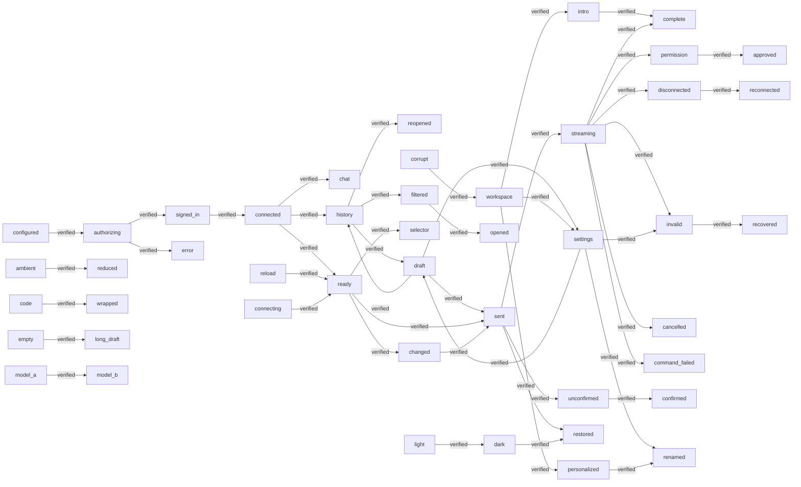

# Coverage

Generated by `pnpm coverage:generate`. Browser percentages cover feature infrastructure; component behavior is covered through journeys, never component unit tests.

Cucumber: 48/48 scenarios passed. Extension Playwright: 7 passed, 0 failed.

## System Journey Graph

Edges come from scenario transition tags. An edge is verified only when all scenarios declaring it passed.

## State-Fusion Matrix

Rows record states asserted together in one executed scenario; this is observed coverage, not an exhaustive Cartesian-product claim.

| Journey | Mood | Name | Ambient | Reduce Motion | Validation | Recovery | Intro | Result |
| --- | --- | --- | --- | --- | --- | --- | --- | --- |
| Verify a device code and choose a workspace | — | — | — | — | — | — | — | passed |
| Malformed account data never grants conversation access | — | — | — | — | — | — | — | passed |
| Reduce Motion suppresses decorative shaders | — | — | ✓ | ✓ | — | — | — | passed |
| Render real Loro history through Lody message and composer controls | — | — | — | — | — | — | — | passed |
| Reopen real cloud conversation history after reload | — | — | — | — | — | — | — | passed |
| Read the introduction at my own pace | — | — | — | — | — | — | ✓ | passed |
| Stream a reply, inspect official tool output and continue chatting | — | — | — | — | — | — | — | passed |
| Approve a permission request once and persist its outcome | — | — | — | — | — | — | — | passed |
| A disconnected stream catches up without losing a draft or duplicating the turn | — | — | — | — | — | — | — | passed |
| A malformed remote turn shows an error and recovers on the next valid update | — | — | — | — | — | — | — | passed |
| The official canceled status ends the active reply and preserves its content | — | — | — | — | — | — | — | passed |
| Stop sends the active turn identity through the machine RPC | — | — | — | — | — | — | — | passed |
| A denied command response stream releases the composer and reports the failure | — | — | — | — | — | — | — | passed |
| Recover an acknowledged turn after interrupted local cleanup without sending it twice | — | — | — | — | — | — | — | passed |
| A single available assistant is ready without a setup dialog | — | — | — | — | — | — | — | passed |
| Drafts survive settings and switching conversations | — | — | — | — | — | — | — | passed |
| Search history and reopen a conversation | — | — | — | — | — | — | — | passed |
| A long draft leaves send and navigation reachable in a short sidebar | — | — | — | — | — | — | — | passed |
| The first message creates the conversation | — | — | — | — | — | — | — | passed |
| An old empty conversation does not block an unsent webpage question | — | — | — | — | — | — | — | passed |
| Connecting uses a small status beside the composer and clears when ready | — | — | — | — | — | — | — | passed |
| Page and selection references travel with the question in one text input | — | — | — | — | — | — | — | passed |
| Agent identity drives brand icons throughout a narrow composer | — | — | — | — | — | — | — | passed |
| Agent identity drives brand icons throughout a narrow composer | — | — | — | — | — | — | — | passed |
| Agent identity drives brand icons throughout a narrow composer | — | — | — | — | — | — | — | passed |
| Agent identity drives brand icons throughout a narrow composer | — | — | — | — | — | — | — | passed |
| Agent identity drives brand icons throughout a narrow composer | — | — | — | — | — | — | — | passed |
| Agent identity drives brand icons throughout a narrow composer | — | — | — | — | — | — | — | passed |
| Agent identity drives brand icons throughout a narrow composer | — | — | — | — | — | — | — | passed |
| Agent identity drives brand icons throughout a narrow composer | — | — | — | — | — | — | — | passed |
| Recently active conversations precede newer but quiet conversations | — | — | — | — | — | — | — | passed |
| Open an existing conversation from real cloud snapshots | — | — | — | — | — | — | — | passed |
| Switching models uses each model's declared controls | — | — | — | — | — | — | — | passed |
| The declared permission default is submitted consistently | — | — | — | — | — | — | — | passed |
| The declared permission default is submitted consistently | — | — | — | — | — | — | — | passed |
| Both permission controls stay synchronized before sending | — | — | — | — | — | — | — | passed |
| Both permission controls stay synchronized before sending | — | — | — | — | — | — | — | passed |
| A mode configuration can be sent without a legacy mode declaration | — | — | — | — | — | — | — | passed |
| Light and dark choices persist in a narrow sidebar | — | — | — | — | — | — | — | passed |
| Change and persist the "outline" icon mood | ✓ | — | — | — | — | — | — | passed |
| Change and persist the "duotone" icon mood | ✓ | — | — | — | — | — | — | passed |
| Change and persist the "fill" icon mood | ✓ | — | — | — | — | — | — | passed |
| Change and persist the "pixel" icon mood | ✓ | — | — | — | — | — | — | passed |
| Change and persist the "glass" icon mood | ✓ | — | — | — | — | — | — | passed |
| Save a personal name | — | ✓ | — | — | — | — | — | passed |
| Reject a blank name | — | — | — | — | ✓ | — | — | passed |
| Compose mood, name and ambient preferences | ✓ | ✓ | ✓ | — | — | — | — | passed |
| Recover invalid stored preferences | — | — | — | — | — | ✓ | — | passed |

## Feature Namespace Disposition

| Namespace | Disposition | Owner | Evidence | Scope |
| --- | --- | --- | --- | --- |
| preferences | active | [src/features/preferences](./src/features/preferences) | 10/10 passed | Mood, name, durable storage and recovery. |
| ambient | active | [src/features/ambient](./src/features/ambient) | 1/1 passed | Opt-in shader effects and system Reduce Motion. |
| introduction | active | [src/features/introduction](./src/features/introduction) | 1/1 passed | Host-controlled Cuelens onboarding. |
| account | active | [src/features/account](./src/features/account) | 2/2 passed | Device authorization, session validation and workspace selection through controlled HTTP. |
| conversations | active | [src/features/conversations](./src/features/conversations) | 34/34 passed | Authenticated submission and recovery of uncertain delivery through controlled HTTP. |
| extension | integration | [tests/extension](./tests/extension) | 7 passed | Packaged MV3 cross-page behavior is verified by Playwright. |
| custom-ui | reserved | [src/shared/ui](./src/shared/ui) | not run | User-owned component library integration boundary. |

## Browser Infrastructure Coverage

| Metric | Percent |
| --- | --- |
| statements | 66.72% |
| branches | 59.3% |
| functions | 70.7% |
| lines | 71.25% |

Raw reports: `reports/cucumber.json`, `reports/extension.json`, and `coverage/browser/coverage-summary.json`. Missing reports are never counted as passing.
