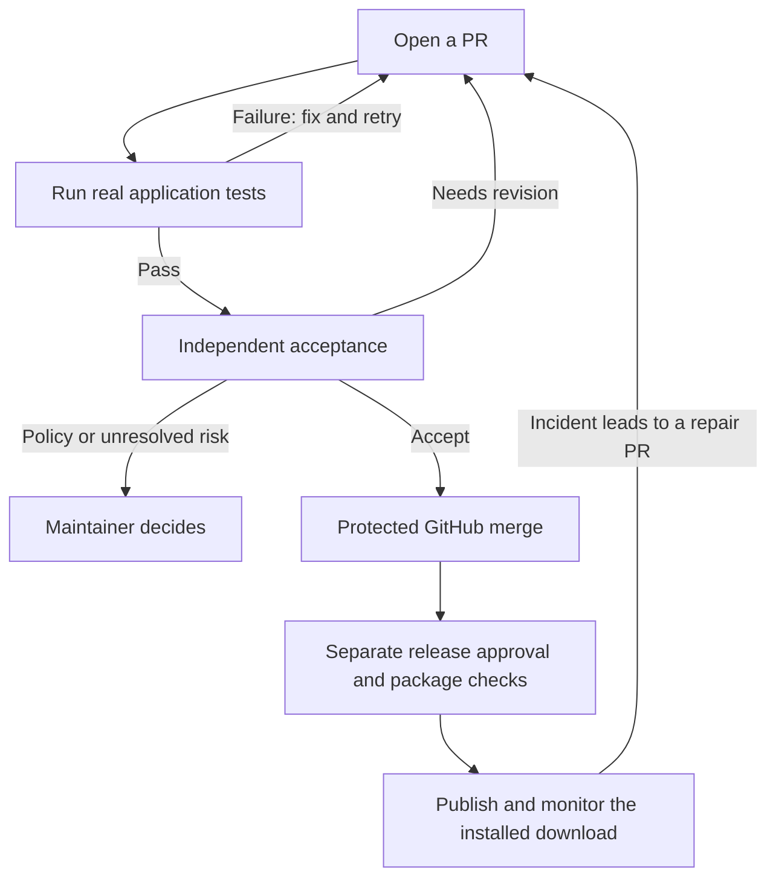

# Autonomous repository maintenance

This automation checks contributions, asks an independent reviewer to verify them, and requests a protected merge when the evidence is sufficient.
After merging, separate workflows prepare releases and test the installed download.

**Current status: the implementation is in this branch; unattended operation is not enabled or verified.**
The tooling tests pass, but missing build inputs and GitHub configuration still block the real end-to-end rollout.
See the [validation record](./VALIDATION.md) for what actually ran.

## How a contribution moves through the system

This is the intended flow after the external services and GitHub rules are installed.

The current personal-repository policy uses protected auto-merge with strict required checks and a current base.
Merge Queue is a separate optional strategy for eligible repositories.
Protected auto-merge does not require moving this repository to an organization.

Passing CI is one input to review.
The reviewer also checks that tests prove the changed behavior, images show the actual affected interface, and the evidence belongs to the current commit.
A new push requires fresh evidence.
Changes to the rules themselves require approval outside the change.

## If you are contributing

1. Use the [PR template](../../.github/PULL_REQUEST_TEMPLATE.md) to describe the user outcome and relevant journeys.
2. Add or update real browser journeys when behavior changes.
   Reuse the existing [assurance model](../assurance/README.md).
3. For UI changes, describe the routes and states to capture using [capture plans](./UI.md).
   The trusted capture job takes the images; the protected adapter uses `gh pr edit --attach` with `--body-file` to publish GitHub attachments and embed previews in the PR body.
   Capture-plan files contain instructions only.
   Screenshot images stay in ignored temporary reports and CI artifacts; never commit them to Git.
4. Read the automated feedback and fix the reported problem.
   An unavailable reviewer, stale image or failed test blocks acceptance.

A documentation-only Markdown change needs appropriate documentation checks and an explanation of why browser evidence is unnecessary.
It does not need a made-up application journey.
See the [example PR bodies and adversarial exercises](./examples/README.md).

## If you are setting up the automation

Start with `pnpm autonomy:preflight`.
It only reads GitHub configuration and reports what is missing or inaccessible.
It does not change permissions, create secrets or enable merging.
Direct attachment publication requires runtime support for `gh pr edit --attach` and a separate environment-only `AUTONOMY_IMAGE_TOKEN` (a repository-restricted fine-grained PAT is recommended); installation tokens are rejected by the CLI attachment client.
The acceptance App retains its separate privileges and check identity.
No external HTTP image endpoint is needed.
Remote upload and PR-body rewriting remain unverified; see the [runbook](./RUNBOOK.md).

| Blocker observed in this session                                                                                         | What must happen before rollout                                                                    |
| ------------------------------------------------------------------------------------------------------------------------ | -------------------------------------------------------------------------------------------------- |
| Runeicons could not be fetched; generated icons are missing                                                              | Restore authorized access, then run the real browser, extension and capture journeys               |
| System GitHub CLI confirms public visibility, auto-merge enabled and administrator API access; main is not protected yet | Deploy and validate the new checks, then require their exact App identities on main                |
| The personal-repository policy selects protected auto-merge; Merge Queue is optional                                     | Keep strict checks, fresh acceptance and an up-to-date base; organization migration is unnecessary |
| Acceptance App, independent reviewer and dedicated CI attachment credentials are not configured                          | Finish service configuration; the three protected environments have been created and verified      |

The [validation record](./VALIDATION.md) lists passing tooling checks and failed or unavailable product checks.
Local fixtures do not prove that GitHub will reject an unsafe remote merge.

## Where to look next

| I need to…                                      | Read                                               |
| ----------------------------------------------- | -------------------------------------------------- |
| Configure GitHub, the App and external services | [Setup and recovery runbook](./RUNBOOK.md)         |
| Understand what can authorize or revoke a merge | [Governance and freshness limits](./GOVERNANCE.md) |
| Declare useful UI captures                      | [UI evidence guide](./UI.md)                       |
| Run a real controlled regression                | [Behavioral probe guide](./PROBES.md)              |
| Operate releases and incidents                  | [Release and monitoring guide](./RELEASE.md)       |
| Understand the approach to verification         | [Verification design](./VERIFICATION-DESIGN.md)    |

GitHub success checks have no native expiry.
The revoker detects stale decisions asynchronously, so strict expiry at the exact moment of merging remains a documented platform limitation.
Keep that limitation visible when assessing readiness.
