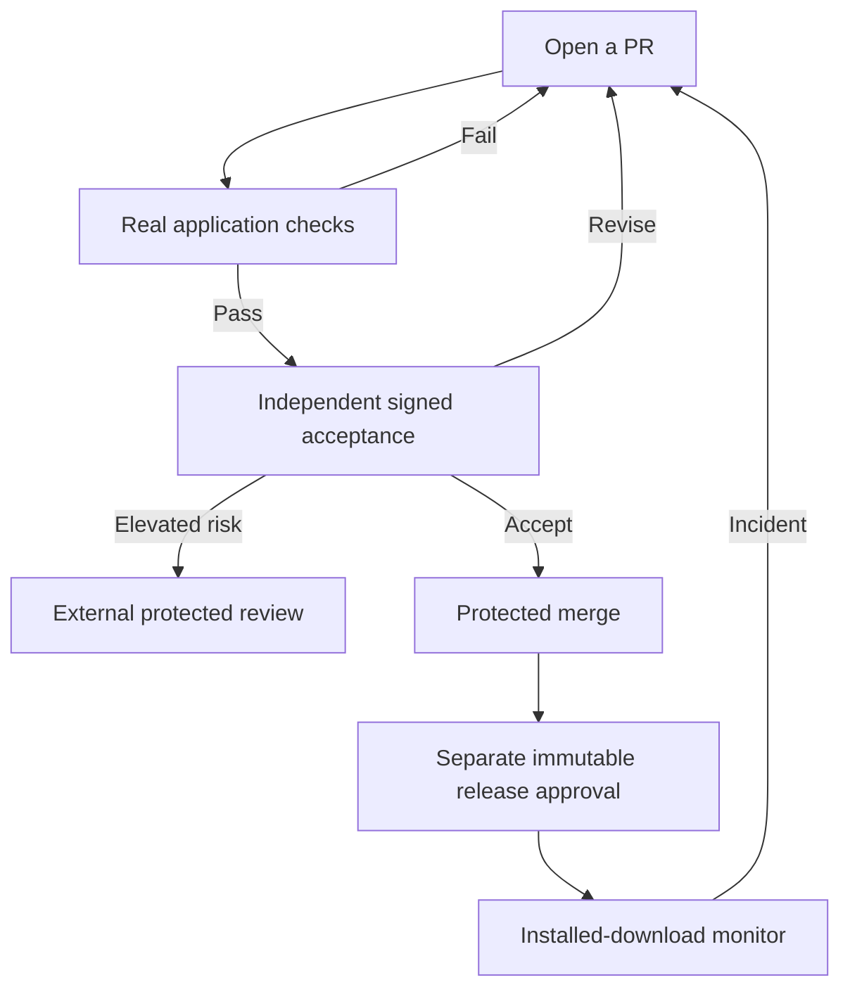

# Autonomous repository maintenance

Automation combines real application evidence, signed independent Dots review and deterministic policy checks before requesting a protected merge.
Separate workflows approve immutable releases and monitor the installed download.
**Unattended operation is not installed or verified.**
See the [validation record](./VALIDATION.md) for observed results and blockers.

1. Describe the outcome, change type, affected areas and model journeys in the [PR template](../../.github/PULL_REQUEST_TEMPLATE.md).
2. Update real browser/extension journeys for behavior changes using the [assurance model](../assurance/README.md).
3. For UI changes, link a [capture plan](./UI.md); trusted capture produces current-SHA before/candidate images and the publisher embeds GitHub attachments in the PR body.
   Keep PNGs in ignored reports and CI artifacts, never Git.
4. Fix failed checks or independent review findings; unavailable services, stale evidence and missing validators block acceptance.

Plain Markdown changes need genuine documentation checks and an explanation of why browser/UI evidence is inapplicable.
Actual diff classification determines obligations; labels cannot waive them.
Contributors write Markdown, not JSON dumps, in the primary PR flow.
See [example bodies and adversarial pilots](./examples/README.md).

| Task                                                          | Guide                                           |
| ------------------------------------------------------------- | ----------------------------------------------- |
| Install services, credentials, protection or recover failures | [RUNBOOK](./RUNBOOK.md)                         |
| Understand merge authority and freshness limits               | [Governance](./GOVERNANCE.md)                   |
| Declare capture plans and consume screenshot interfaces       | [UI evidence](./UI.md)                          |
| Run controlled behavioral regressions                         | [Probes](./PROBES.md)                           |
| Operate tags, publication and incidents                       | [Releases](./RELEASE.md)                        |
| Understand evidence design                                    | [Verification design](./VERIFICATION-DESIGN.md) |

Start installation with `pnpm autonomy:preflight`.
The personal-repository default is protected auto-merge; Merge Queue is optional for eligible repositories.
Neither green tooling tests nor enabled repository auto-merge proves live enforcement.
